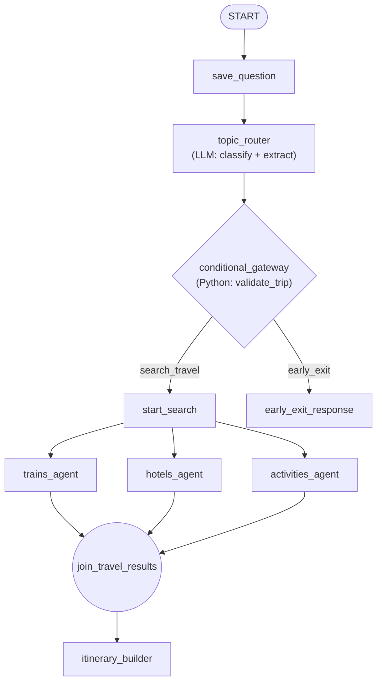

# Travel Planner: a multi-agent trip planning workflow

A travel planner built with **Google's Agent Development Kit (ADK) 2.x**. You describe a trip in plain English; a team of agents searches trains, hotels and activities **in parallel** and a final agent combines the results into one itinerary.

Before any search runs, the request is checked for things that would waste time and money: off-topic messages, trips in the past, journeys that cannot fit the dates, and activities that make no sense at the destination. Bad requests are stopped early with a clear reason, and the search agents never see them.

> Example: *"Plan me a trip to Mysore from Kalyan on 30th October and back home on 5th November"*

---

## Table of contents

1. [Features](#features)
2. [Example requests](#example-requests)
3. [How it works](#how-it-works)
4. [Safety and robustness](#safety-and-robustness)
5. [Project structure](#project-structure)
6. [Tech stack](#tech-stack)
7. [Known limitations](#known-limitations)


---

## Features

- **Graph-based workflow** built with ADK's `Workflow`: explicit nodes, edges, routes, fan-out and fan-in.
- **Parallel search**: trains, hotels and activities agents run at the same time and are merged by a `JoinNode`.
- **Structured routing**: an LLM router classifies the message and extracts origin, destination, dates and activities into a typed schema (`RouterDecision`).
- **Deterministic trip validation**: Python (not the LLM) does the date arithmetic and rejects impossible trips before any search.
- **Mixed requests handled**: if a message mixes a trip with something unrelated, the trip is planned, the rest is skipped, and the user is told what was skipped.
- **Prompt-injection defences**: an input guard, a tool-result scrubber and an output guard.
- **Graceful failure**: quota (HTTP 429) errors produce a role-specific fallback instead of crashing the workflow.
- **Tested**: 42 deterministic unit tests that need no API key, plus ADK evaluation sets for the LLM parts.

## Example requests

| You type | What happens |
|---|---|
| `Plan me a trip to Mysore from Kalyan on 30th October and back home on 5th November` | Full itinerary: trains, hotels, day-by-day plan, costs, tips |
| `... and meanwhile write a brute force approach for 2sum` | Itinerary for the trip, plus a notice that the coding request was skipped. No code is produced |
| `Plan a same-day trip from Kalyan to Kanyakumari and return the same day` | Refused with a reason: the journey takes about 40 hours one way, so a round trip needs more days |
| `Plan a trip from Kalyan to Mysore from 30th October 2020 to 5th November 2020` | Refused: the dates are in the past |
| `Plan a trip from Kolkata to Puri, I want to go mountain climbing` | Refused: mountain climbing is not realistic in flat coastal Puri (with a suggested alternative) |
| `Hii` or `Write a Python function for two sum` | Polite refusal. Nothing is searched |

## How it works



### The nodes

| Node | Type | Job |
|---|---|---|
| `save_question` | Python function | Stores the raw message and today's date in the shared state |
| `topic_router` | LLM agent | Decides whether the message is travel related, extracts the trip facts into `RouterDecision`, and separates the travel part from any unrelated part |
| `conditional_gateway` | Python function | Runs `validate_trip`, shows the "skipped" notice if needed, then picks the route `search_travel` or `early_exit` |
| `start_search` | Python function | Fan-out point: passes the cleaned request to the three specialists |
| `trains_agent`, `hotels_agent`, `activities_agent` | LLM agents + tools | Search in parallel and save their results to the state |
| `join_travel_results` | `JoinNode` | Waits until all three specialists have finished |
| `itinerary_builder` | LLM agent | Writes the final itinerary using only the data the specialists returned |
| `early_exit_response` | Python function | Shows the refusal or rejection reason to the user |

### Shared state

Every node reads and writes one shared dictionary. Agents read it through placeholders such as `{question}` in their instructions.

| Key | Written by | Meaning |
|---|---|---|
| `question` | `save_question`, then `conditional_gateway` | The user's message, later replaced by the cleaned travel-only request |
| `today` | `save_question` | Today's date (used to resolve dates like "30 Oct" and to detect past trips) |
| `router_decision` | `topic_router` | The structured classification and extracted facts |
| `notice` | `conditional_gateway` | "I skipped part of your message" text, if any |
| `reply` | `early_exit_response` | The refusal or rejection reason, if any |
| `train_options` | `trains_agent` | Train search results |
| `hotel_options` | `hotels_agent` | Hotel search results |
| `activity_options` | `activities_agent` | Activity search results |
| `final_itinerary` | `itinerary_builder` | The finished itinerary (Markdown) |


## Safety and robustness

### Trip validation (`tools/validation.py`)

The router only **extracts** facts. Python **decides**, because LLMs are unreliable at date arithmetic. Checks run in this order:

| # | Check | Example rejection |
|---|---|---|
| 1 | Origin and destination are the same place | "Your starting point and destination are the same place" |
| 2 | Trip starts or ends in the past | "...which is in the past (today is 21 October 2026)" |
| 3 | Return date is before the departure date | "Your return date is before your departure date" |
| 4 | Round trip does not fit the journey time | "takes about 40 hours one way by train, so a same-day return is not possible. A round trip needs at least 4 days" |
| 5 | Requested activity cannot be done at the destination (judged by the router) | "Mountain climbing is not realistic in flat coastal Puri..." |

Check 4 needs `2 x one-way hours + MIN_HOURS_AT_DESTINATION` to fit in the dates. `MIN_HOURS_AT_DESTINATION` (default 12) is defined at the top of `validation.py`. Unknown or malformed values skip the check instead of crashing.

### Prompt-injection guardrails (`tools/callback.py`)

| Guard | Hook | What it does |
|---|---|---|
| `router_input_guard` | `before_model_callback` on the router | Blocks known injection phrases and messages over 2,000 characters before the model is called |
| `tool_result_guard` | `after_tool_callback` on each specialist | Drops instruction-like sentences from search results and caps field length. Search results are untrusted text |
| `itinerary_output_guard` | `after_model_callback` on the builder | Removes code blocks from the itinerary |

These are speed bumps, not walls: the input guard is a phrase list and can be bypassed by rewording. The structural defences matter more: the router extracts only travel facts, the gateway forwards only the cleaned request, and the builder is told to use only the specialists' data.

### Quota and error handling

Parallel specialists can hit model rate limits (HTTP 429). `callback.py` provides one fallback per role:

| Role | Handler | Fallback |
|---|---|---|
| Router | `handle_router_quota_error` | JSON in the full `RouterDecision` shape, so the gateway shows a "try again" message |
| Specialists | `handle_specialist_quota_error` | A `NO RESULTS` note for the builder, so the `JoinNode` still receives an output instead of hanging |
| Builder | `handle_builder_quota_error` | A message shown to the user |

Only real 429 or `RESOURCE_EXHAUSTED` errors are handled; every other error passes through to ADK.

### Honesty rules for the builder

The itinerary builder may only use what the specialists returned. Missing prices are written as `Price N/A`, empty sections as `No live data available`, and trains are checked for direction (outbound versus return).

## Project structure

```

    travel_planning_agent/         # the ADK agent package (what adk web loads)
    ├── __init__.py                # from . import agent
    ├── agent.py                   # the workflow: nodes, schema, routing, root_agent
    ├── Runner.py                  # command-line runner (explicit Runner + InMemorySessionService)
    ├── subagents/
    │   ├── trains_finder/         # trains_agent    (output_key: train_options)
    │   ├── hotels_finder/         # hotels_agent    (output_key: hotel_options)
    │   └── activities_finder/     # activities_agent (output_key: activity_options)
    ├── tools/
    │   ├── trains.py              # train search tool
    │   ├── hotels.py              # hotel search tool
    │   ├── activities.py          # activity search tool
    │   ├── serp_api.py            # SerpAPI helper used by the search tools
    │   ├── validation.py          # deterministic trip checks
    │   └── callback.py            # quota handlers and prompt-injection guards        
    ├── tests/                     # deterministic unit tests (no API key needed)
    ├── docs/
    ├── .env                       # local settings and secrets 
    └── pyproject.toml
    
```

## Tech stack

- **Python 3.12**, managed with **uv**
- **Google ADK 2.12.0** (`Workflow`, `JoinNode`, `Agent`, `Runner`, `callbacks`)
- **Gemini** (`gemini-3.6-flash`) on **Vertex AI**
- **Pydantic** for the router's structured output
- **SerpAPI** for live search results
- **pytest** for tests, **ADK eval sets** for LLM behaviour


## Known limitations

- **Journey times are estimates.** The router gives an estimated one-way train time from the model's memory. The 12-hour margin and the "clearly impossible only" rule limit false rejections, but a wrong estimate can still reject a valid trip or allow a tight one.
- **Activity checks are judgement calls.** Borderline cases (for example trekking near a coast) can go either way.
- **The input guard is a phrase list.** A reworded injection can get past it. The router's extraction and the cleaned-request design are the main defences.
- **Live data varies.** Train availability, hotel prices and links come from search results at request time and can be missing. The builder reports gaps instead of filling them.
- **Single-turn workflow.** A second message starts the whole pipeline again. Follow-up edits ("make it two nights shorter") are not supported yet.
- **Sessions are in memory locally.** They disappear when the process ends.
- **Rate limits.** Three specialists run at once, so a busy model quota can produce fallback messages.
- **Only trains are searched.** Flights are not part of the current workflow.
